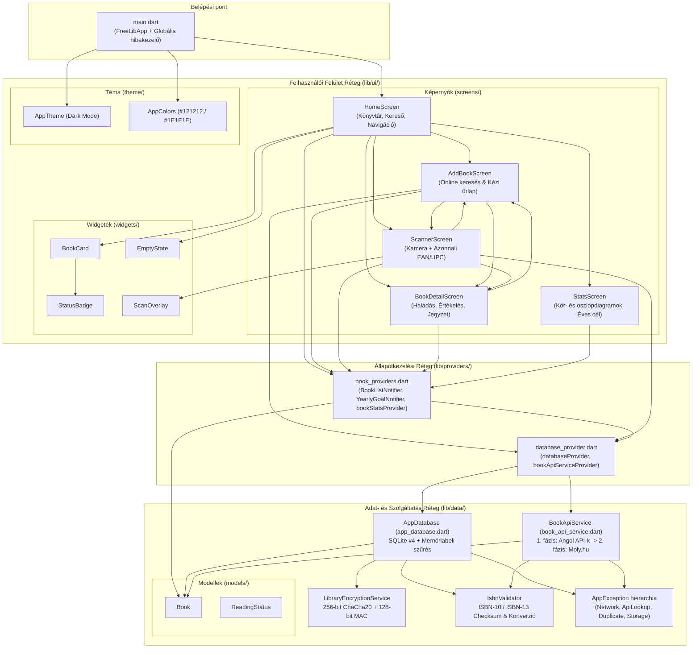

# 2. Komponens- és Modul-függőségi Gráf (Component & Module Dependency Graph)

Ez a dokumentum a **FreeLib** alkalmazás teljes belső komponens-architektúráját, a Dart modulok közötti irányított függőségi gráfot, a külső (`pub.dev` és natív Android) csomagkapcsolatokat, valamint a fő adatfolyamokat szemlélteti.

---

## 2.1 Magas szintű Réteg- és Komponens-architektúra

---

## 2.2 Folyamatábra: Kétfázisú ISBN Keresés és Titkosított Mentés

Az alábbi szekvenciadiagram a vonalkód-beolvasástól (`ScannerScreen`) az angol/magyar API-kon át a ChaCha20-titkosított SQLite mentésig tartó folyamatot ábrázolja:

```mermaid
sequenceDiagram
    autonumber
    actor User as Felhasználó
    participant Scan as ScannerScreen (ML Kit)
    participant Val as IsbnValidator
    participant Notifier as BookListNotifier
    participant Api as BookApiService
    participant Crypto as LibraryEncryptionService
    participant DB as AppDatabase (SQLite)

    User->>Scan: Vonalkód kamera elé tartása (returnImage: false)
    Scan->>Val: normalize(rawValue)
    Val-->>Scan: Érvényes ISBN-13 / ISBN-10
    Scan->>DB: getBookByIsbn(isbn) (Duplikáció-ellenőrzés)
    DB-->>Scan: null (Még nincs a könyvtárban)
    Scan->>Notifier: scanAndAdd(isbn)
    Notifier->>Api: lookupByIsbn(isbn)

    rect rgb(25, 45, 65)
        Note over Api: 1. FÁZIS — Gyors Angol / Nemzetközi JSON API-k
        Api->>Api: 1.1 Google Books API (ISBN-13, majd ISBN-10)
        Api->>Api: 1.2 Open Library Direct Batch API (ISBN-13 + ISBN-10 együtt)
        Api->>Api: 1.3 Open Library Search API
    end

    alt Nem található az angol API-kban
        rect rgb(60, 40, 25)
            Note over Api: 2. FÁZIS — Magyar tartalék (Moly.hu HTML kereső)
            Api->>Api: 2.1 Moly.hu keresés és adatfeldolgozás
        end
    end

    Api-->>Notifier: Feloldott Book objektum (+ Japán->Romaji fordítás ha szükséges)
    Notifier->>DB: insertBook(book)
    DB->>Crypto: encryptBookMap(book.toMap())
    Crypto-->>DB: ENC1:<base64> (256-bit ChaCha20 + MAC)
    DB-->>Notifier: Beszúrt sor ID
    Notifier-->>Scan: Mentett Book példány
    Scan->>User: Megnyitja a BookDetailScreen adatlapot
```

---

## 2.3 Külső Csomag-függőségi Mátrix (`pubspec.yaml` -> Dart modulok)

| Külső csomag (`pubspec.yaml`) | Verzió | Használó belső modul(ok) | Szerep a rendszerben |
| :--- | :---: | :--- | :--- |
| `flutter_riverpod` | `^2.6.0` | `main.dart`, `providers/*`, összes `ui/screens/*` | Reaktív állapotkezelés és függőség-befecskendezés (DI) |
| `sqflite` | `^2.4.0` | `lib/data/database/app_database.dart` | Helyi relációs SQLite adatbázis motor |
| `path_provider` & `path` | `^2.1.0` | `app_database.dart`, `library_encryption_service.dart` | Alkalmazás-izolált belső könyvtárak (`ApplicationSupportDirectory`) elérése |
| `dio` | `^5.7.0` | `lib/data/services/book_api_service.dart` | HTTP/JSON kliens időkorlátokkal és hibakövetéssel |
| `mobile_scanner` | `^7.4.0` | `lib/ui/screens/scanner_screen.dart` | Natív ML Kit alapú 1D vonalkódolvasó (`ean13`, `ean8`, `upcA`, `upcE`) |
| `permission_handler` | `^11.3.0` | `lib/ui/screens/scanner_screen.dart` | Kamera-jogosultság ellenőrzése és rendszerbeállítások megnyitása |
| `cached_network_image` | `^3.4.0` | `book_card.dart`, `add_book_screen.dart`, `book_detail_screen.dart` | Borítóképek memóriabeli és helyi gyorsítótárazása |
| `flutter_rating_bar` | `^4.0.1` | `lib/ui/screens/book_detail_screen.dart` | 0.5–5.0 csillagos interaktív értékelő sáv |
| `fl_chart` | `^0.70.0` | `lib/ui/screens/stats_screen.dart` | Állapot szerinti kördiagram (`PieChart`) és havi oszlopdiagram (`BarChart`) |
| `share_plus` | `^13.3.0` | `lib/ui/screens/book_detail_screen.dart` | Könyvajánló szöveges megosztása |
| `intl` | `^0.19.0` | `main.dart`, `lib/ui/screens/book_detail_screen.dart` | Magyar (`hu`) dátumformázás |

