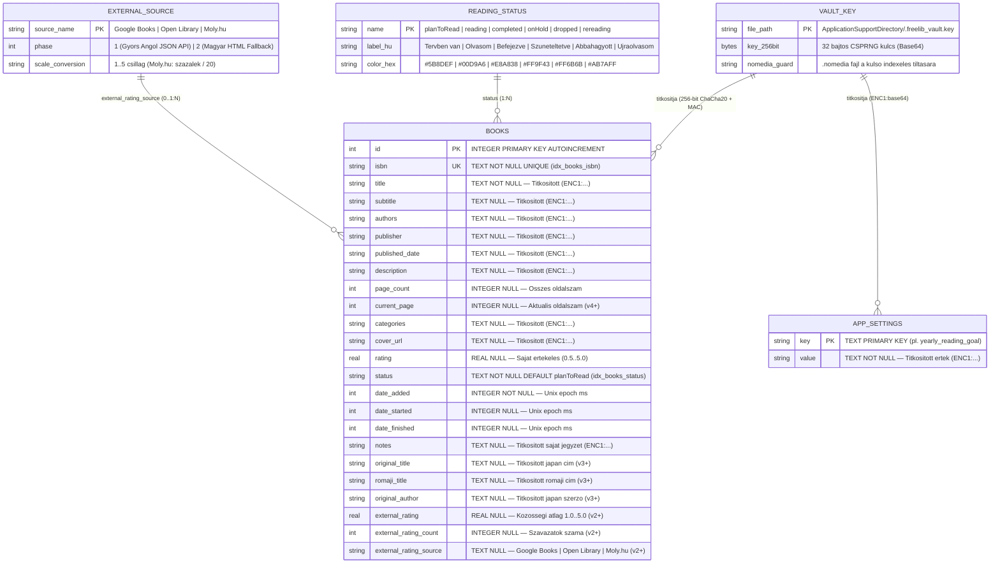

# 3. Entity Relationship Diagram (ERD) és Adatbázis Séma

Ez a dokumentum a **FreeLib** helyi adatbázisának (`freelib.db`, SQLite 4-es sémaverzió), a hozzá kapcsolódó 256 bites ChaCha20 titkosító kulcstárolónak (`.freelib_vault.key`), valamint a logikai domain entitásoknak a felépítését írja le.

---

## 3.1 Fizikai és Logikai Entity Relationship Diagram (Mermaid ERD)

---

## 3.2 Táblák és Mezőszintű Titkosítási Szabályok (`books` tábla)

A `books` tábla 24 oszlopából **12 érzékeny szöveges mező** a háttértárra írás előtt (`insertBook`, `updateBook`, valamint a `_encryptLegacyPlaintextRows` automatikus migráció során) `ENC1:<base64(nonce_12B || ciphertext || mac_tag_16B)>` formátumba kerül:

| Oszlopnév | SQL Típus | Kötelező | Indexelt | Titkosítás a lemezen | Leírás |
| :--- | :--- | :---: | :---: | :---: | :--- |
| `id` | `INTEGER` | Igen (PK) | Primary Key | Nyílt (SQL kulcs) | Automatikusan növekvő egyedi azonosító |
| `isbn` | `TEXT` | Igen | `UNIQUE`, `idx_books_isbn` | Nyílt (Duplikáció-szűréshez) | ISBN-13, ISBN-10 vagy `LOCAL-<timestamp>` |
| `title` | `TEXT` | Igen | `idx_books_title` | 🔒 **ChaCha20-MAC (`ENC1:`)** | A könyv főcíme |
| `subtitle` | `TEXT` | Nem | — | 🔒 **ChaCha20-MAC (`ENC1:`)** | Alcím |
| `authors` | `TEXT` | Nem | — | 🔒 **ChaCha20-MAC (`ENC1:`)** | Szerző(k) vesszővel elválasztva |
| `publisher` | `TEXT` | Nem | — | 🔒 **ChaCha20-MAC (`ENC1:`)** | Kiadó neve |
| `published_date` | `TEXT` | Nem | — | 🔒 **ChaCha20-MAC (`ENC1:`)** | Kiadás éve / dátuma |
| `description` | `TEXT` | Nem | — | 🔒 **ChaCha20-MAC (`ENC1:`)** | Fülszöveg / tartalmi összefoglaló |
| `page_count` | `INTEGER` | Nem | — | Nyílt (SQL `SUM` aggregációhoz) | A könyv teljes oldalszáma |
| `current_page` | `INTEGER` | Nem | — | Nyílt (SQL `SUM` aggregációhoz) | Jelenleg elolvasott oldalszám |
| `categories` | `TEXT` | Nem | — | 🔒 **ChaCha20-MAC (`ENC1:`)** | Műfajok / kategóriák |
| `cover_url` | `TEXT` | Nem | — | 🔒 **ChaCha20-MAC (`ENC1:`)** | Borítókép HTTPS URL |
| `rating` | `REAL` | Nem | — | Nyílt (SQL `AVG` aggregációhoz) | Felhasználói értékelés (`0.5` – `5.0`) |
| `status` | `TEXT` | Igen | `idx_books_status` | Nyílt (SQL `GROUP BY`-hoz) | Olvasási állapot (`ReadingStatus.name`) |
| `date_added` | `INTEGER` | Igen | — | Nyílt (Időrendi rendezéshez) | Hozzáadás időbélyege (ms) |
| `date_started` | `INTEGER` | Nem | — | Nyílt | Olvasás kezdési időbélyege (ms) |
| `date_finished` | `INTEGER` | Nem | — | Nyílt | Befejezés időbélyege (ms) |
| `notes` | `TEXT` | Nem | — | 🔒 **ChaCha20-MAC (`ENC1:`)** | Személyes olvasói jegyzet |
| `original_title` | `TEXT` | Nem | — | 🔒 **ChaCha20-MAC (`ENC1:`)** | Eredeti japán (kanji/kana) cím |
| `romaji_title` | `TEXT` | Nem | — | 🔒 **ChaCha20-MAC (`ENC1:`)** | Latin betűsre átírt japán cím |
| `original_author`| `TEXT` | Nem | — | 🔒 **ChaCha20-MAC (`ENC1:`)** | Eredeti japán szerzőnév |
| `external_rating`| `REAL` | Nem | — | Nyílt | Külső közösségi értékelés (`1.0` – `5.0`) |
| `external_rating_count` | `INTEGER` | Nem | — | Nyílt | Külső értékelések darabszáma |
| `external_rating_source`| `TEXT` | Nem | — | Nyílt | Forrás neve (`Google Books`, `Open Library`, `Moly.hu`) |

---

## 3.3 Séma-evolúció és Migrációs Történet (`_onUpgrade`)

| Verzió | Változás leírása | Adatvesztés-mentes migráció |
| :---: | :--- | :--- |
| **v1** | Alap `books` tábla (18 oszlop) + 3 index (`status`, `title`, `isbn`) | Kezdeti `CREATE TABLE` |
| **v2** | Külső értékelések hozzáadása (`external_rating`, `external_rating_count`, `external_rating_source`) | `ALTER TABLE books ADD COLUMN ...` |
| **v3** | Japán/Romaji metaadat-mezők (`original_title`, `romaji_title`, `original_author`) | `ALTER TABLE books ADD COLUMN ...` |
| **v4** | Olvasási haladás (`current_page`), `app_settings` tábla és automatikus ChaCha20 helyi titkosítás | `ALTER TABLE` + `_encryptLegacyPlaintextRows(db)` |

